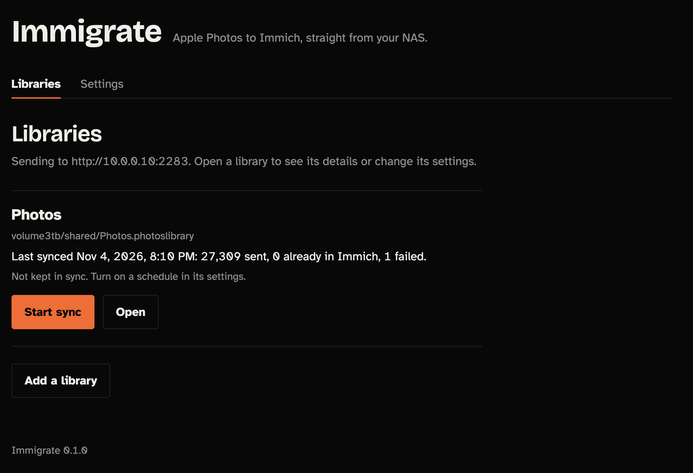
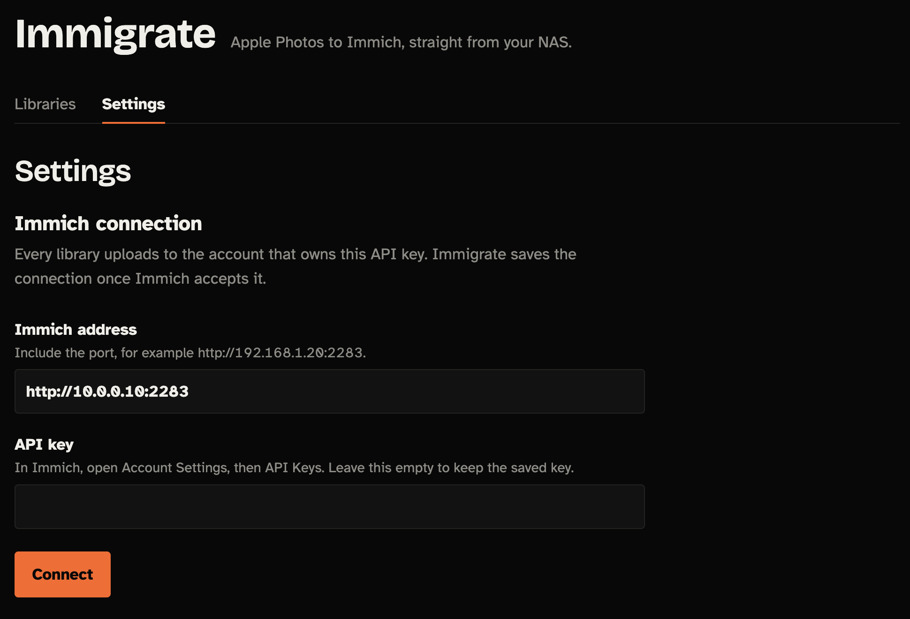
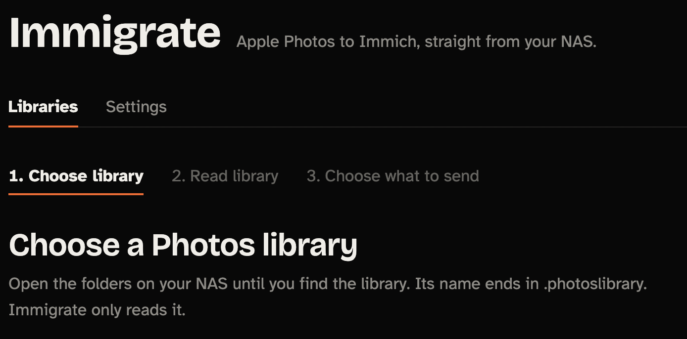
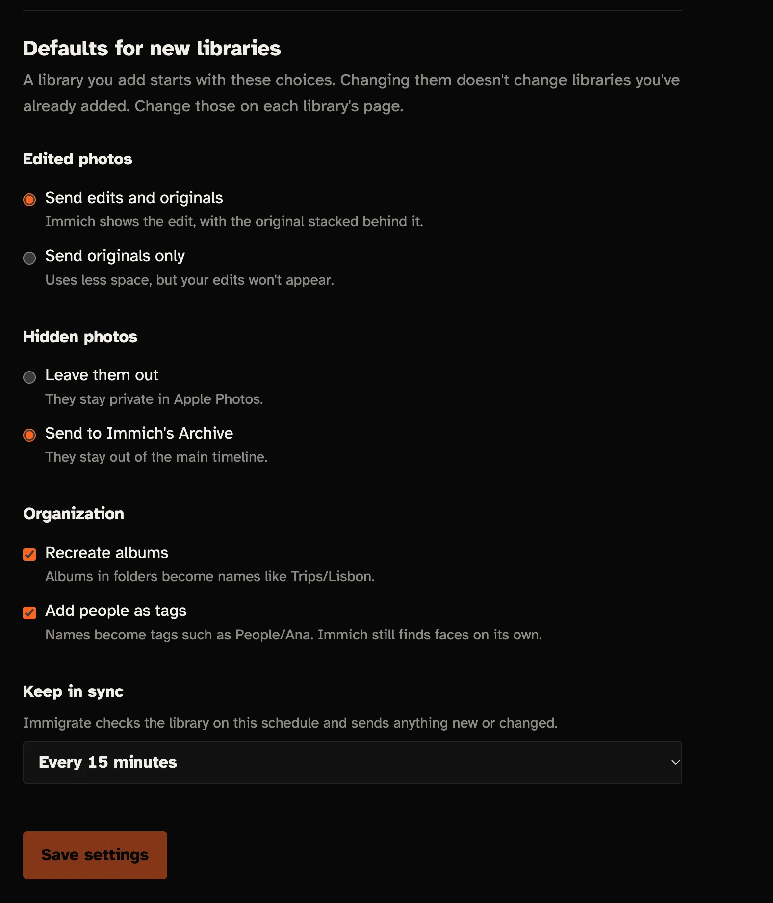
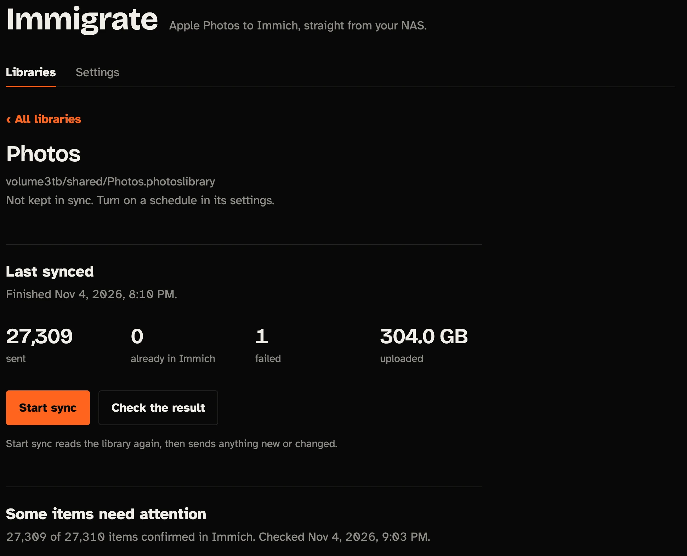

# Immigrate

### Your photos belong on your NAS. Apple Photos just needs to get out of the way.

It started with a simple idea: keep a lifetime of photos safely stored on a NAS, where they belong.

Then Apple Photos decided otherwise.

A massive photo library sitting peacefully on a TrueNAS SMB share suddenly became a problem. Permissions changed. Photos stopped opening. The database passed its integrity checks, but the library still refused to load.

`Path is not writable.`

`Operation not supported.`

`Error 46104.`

The library was there. The photos were there. The database was apparently fine.

But Apple Photos had other plans.

After hours of troubleshooting permissions, SMB settings, ownership, and library repair attempts, one thing became clear:

**Maybe the problem wasn't the photos. Maybe it was the application holding them hostage.**

So instead of fighting Apple Photos any longer, we decided to build a way out.

## Meet Immigrate

Immigrate is an open-source migration assistant designed to help people move their Apple Photos libraries to [Immich](https://immich.app/), their own self-hosted photo management platform.

It exists for people who want control over their photos, their storage, and their memories — without being locked into a single application or cloud service.

The goal is simple:

- Read an Apple Photos library without requiring it to open normally in Photos.
- Extract original photos and videos safely.
- Preserve metadata, dates, locations, and album organization wherever possible.
- Migrate everything to Immich running on your own server.
- Verify the migration before you trust it.
- Never modify or delete your original library during migration.

## Why Immigrate?

Because a photo library should not become inaccessible just because you changed a NAS permission.

Because a lifetime of memories deserves better than a mysterious filesystem error.

**Because your NAS is yours.**

And because sometimes the best solution to an Apple problem is to stop asking Apple for permission.

## The mission

**Get your memories out. Keep your originals safe. Take control of your photo library.**

Immigrate is being built from a real migration problem, with the goal of making the process safe, transparent, and accessible to anyone moving from Apple Photos to Immich.

No cloud subscription required. No proprietary lock-in. Just your photos, your server, and a new home for them.

*Built out of frustration. Driven by the desire to own our memories.*


## What makes the trip

- Reads the `.photoslibrary` through a read-only mount, chosen in a folder browser.
- Sends photos, videos, Live Photos (linked), RAW pairs, and edits (stacked with the original).
- Carries over dates, locations, captions, keywords, favorites, and albums.
- Adds people as tags such as `People/Ana`.
- Resumes after a stop or restart, and only sends what changed on later runs.
- Checks the result by asking Immich what it actually holds.
- Syncs more than one library, each with its own choices and schedule.
- Can keep checking for changes on a schedule, shown on the libraries page.

Sync is one-way and only adds. Immigrate never changes the library, and it
never deletes anything from Immich.

## A look around

Every library you add is listed with its last sync and schedule.



Connect to Immich once in Settings. Every library uploads to the account that owns
the API key.



Add a library by browsing the NAS folders until you find the `.photoslibrary`.



Settings also holds the choices each new library starts with: edited photos, hidden
photos, albums, people, and how often to check for changes.



## Tested on a real library

The library this project was built for went across in one sync: 27,309 photos and
videos, 304 GB. One item failed.



## Here's what you need to do

The image is published to GitHub Container Registry for `amd64` and `arm64`. Install
it on TrueNAS, in Portainer, or with Docker Compose. Each way needs two things first:

- **The folder that holds your library**, and a user and group that can read it.
  See [Point it at your NAS](#point-it-at-your-nas).
- **An Immich API key**, from Account Settings, then API Keys. It needs permission
  to upload, read, and update assets, manage albums, and create stacks. It doesn't
  need to be an admin key. You can enter it in the page after installing.

Once it's running, open `http://YOUR_NAS_IP:8088`, connect to Immich, and browse the
NAS folders until you find your `.photoslibrary`. Review the scan and upload plan
before you start. Your libraries, records, and settings are kept in the
`immigrate-data` volume, so they survive updates.

### TrueNAS SCALE (work in progress)

This works on TrueNAS SCALE 24.10 and later, where apps run on Docker.

1. Go to **Apps**, click **Discover Apps**, open the ⋮ menu, and choose
   **Install via YAML**.
2. Enter `immigrate` as the name.
3. Paste the YAML below. Change `/mnt/tank` to the pool or dataset that holds the
   library, and `3000:3000` to the user and group that can read it.
4. Click **Save**. Immigrate appears in your installed apps.

```yaml
services:
  immigrate:
    # Pin a version, such as :0.2.0, to update only when you choose to.
    image: ghcr.io/filipeamorimdev/immigrate:latest
    restart: unless-stopped
    ports:
      - "8088:8088"
    # The user and group that can read the library.
    user: "1000:1000"
    environment:
      LOG_LEVEL: INFO
    volumes:
      # The dataset you choose the library from in the page. :ro keeps it read-only.
      - /mnt/tank:/nas:ro
      - immigrate-data:/data
    read_only: true
    tmpfs:
      - /run
    security_opt:
      - no-new-privileges:true
    cap_drop:
      - ALL

volumes:
  immigrate-data:
```

TrueNAS doesn't read a `.env` file here, so the values go straight into the YAML.
To change them later, select the app and click **Edit**. To update, edit the app and
change the version in `image`.

To find the user and group, open **System**, then **Shell**, and run the `stat`
command from [Point it at your NAS](#point-it-at-your-nas) on your library.

### Portainer

1. Go to **Stacks** and click **Add stack**. Enter `immigrate` as the name.
2. Choose **Repository**, enter `https://github.com/filipeamorimdev/immigrate`, and
   leave the compose path as `compose.yaml`. You can also choose **Web editor** and
   paste in [`compose.yaml`](compose.yaml).
3. Under **Environment variables**, add `NAS_FOLDER`, `IMMIGRATE_UID`, and
   `IMMIGRATE_GID`. To set them all at once, click **Load variables from .env file**
   and choose a copy of [`.env.example`](.env.example) with your values filled in.
4. Click **Deploy the stack**.

To update, open the stack, turn on **Re-pull image and redeploy**, and click
**Update the stack**.

### Docker Compose

On the NAS, in a new folder:

```bash
curl -fsSLO https://raw.githubusercontent.com/filipeamorimdev/immigrate/main/compose.yaml
curl -fsSL -o .env https://raw.githubusercontent.com/filipeamorimdev/immigrate/main/.env.example
# Set NAS_FOLDER and IMMIGRATE_UID/GID in .env (see below), then:
docker compose up -d
```

To update, run `docker compose pull`, then `docker compose up -d`.

## Point it at your NAS

`NAS_FOLDER` is the folder on your NAS that the page can browse. It's mounted
read-only, and nothing outside it can be reached. The default, `/mnt`, suits
TrueNAS. On other systems, set it to where your shared folders are:

| NAS | Shared folders are in | Example |
| --- | --- | --- |
| TrueNAS SCALE | `/mnt/<pool>` | `/mnt/tank` |
| Synology DSM | `/volume1/<shared folder>` | `/volume1/photo` |
| Unraid | `/mnt/user/<share>` | `/mnt/user/photos` |
| QNAP QTS | `/share/CACHEDEV1_DATA/<shared folder>` | `/share/CACHEDEV1_DATA/Multimedia` |
| OpenMediaVault | `/srv/dev-disk-by-uuid-<id>/<shared folder>` | |
| Other Linux | Wherever the disk that holds the library is mounted | |

- **Use the real folder, not a link to it.** A link that points outside
  `NAS_FOLDER` doesn't show up in the page. On QNAP, `/share/Multimedia`
  is a link, so use `/share/CACHEDEV1_DATA/Multimedia` or
  `/share/CACHEDEV1_DATA`.
- **Check that the folder exists.** If it doesn't, Docker creates an empty one
  and the page shows no folders.

`IMMIGRATE_UID` and `IMMIGRATE_GID` must be a user and group that can read
the library. To use the ones that own it, run this on the NAS and copy the two
numbers it prints:

```bash
stat -c '%u %g' "/volume1/photo/Photos Library.photoslibrary"
```

If the page says it can't open a folder, this is usually the cause.

## Before you start

- **Originals must be on the NAS.** If the library used Optimize Mac Storage,
  some originals are only in iCloud. The Review step counts them. To fix this,
  choose Download Originals to this Mac in Photos, then copy the library back.
- **Don't sync while Photos has the library open.** Close Photos first, or use a
  copy of the library.
- **Plan for space.** Immich stores its own copy of each file, plus thumbnails
  and transcoded videos. The Choose step shows the upload size.
- **Allow temporary space.** The Photos database is copied into `/data/tmp`
  while it's read. It can be several GB on a large library. The copy is deleted
  when the read ends. If a read doesn't finish, a library's page offers to
  delete what it left.

## Configuration

| Variable | Default | Purpose |
| --- | --- | --- |
| `NAS_FOLDER` | `/mnt` | Host folder to choose the library from, mounted read-only |
| `IMMIGRATE_UID`, `IMMIGRATE_GID` | `1000` | User that runs the container |
| `IMMIGRATE_PORT` | `8088` | Port on the host |
| `IMMICH_URL`, `IMMICH_API_KEY` | empty | Optional. Otherwise, enter them in the page |
| `LOG_LEVEL` | `INFO` | Log detail |

The time zone is chosen in Settings in the page. It's used for times on the page
and in the log. Until you choose one, Immigrate uses `TZ` if it's set, and UTC if not.

## Known limits

- Named people arrive as tags, not as Immich people. Immich runs its own face recognition.
- Smart Albums aren't recreated.
- If you change an edit after syncing, the new version is added and the old one stays.
- Removing a photo from an album in Apple Photos doesn't remove it from the Immich album.
- There's no login, so run it on your own network only. The API key is stored in
  the `/data` volume and never sent to the browser. Requests from other websites
  are refused.
- Anyone who can open the page can see the folder names inside `NAS_FOLDER`, but
  not the files. Set it to a narrower folder to show less.

## Development

See [CONTRIBUTING.md](CONTRIBUTING.md) and [docs/architecture.md](docs/architecture.md).

## Acknowledgments

Immigrate reads the Photos library with
[osxphotos](https://github.com/RhetTbull/osxphotos). The interface uses the
Bricolage Grotesque and Atkinson Hyperlegible typefaces, whose licenses are in
`src/immigrate/static/fonts`.

## License

Immigrate is released under the [MIT License](LICENSE).
